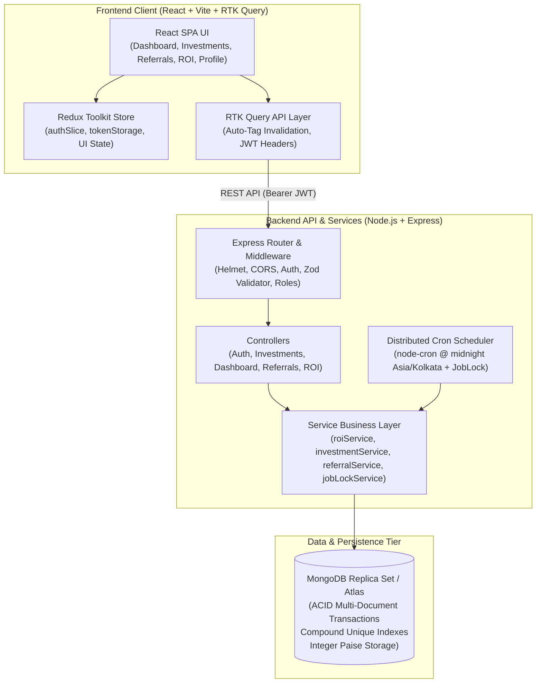

# NexaChain – Investment & Referral Management Platform

[](backend/src/tests/)
[](frontend/)
[](https://nodejs.org/)
[](docs/MONGODB_PRODUCTION_SETUP.md)
[](LICENSE)

NexaChain is an enterprise-grade full-stack financial platform designed for high-precision investment management, multi-tier downline referral networks, and automated daily Return on Investment (ROI) distribution with ACID transaction guarantees.

---

## Table of Contents

1. [Project Overview](#1-project-overview)
2. [Architecture & System Design](#2-architecture--system-design)
3. [Technology Stack](#3-technology-stack)
4. [Project Structure](#4-project-structure)
5. [Key Platform Features](#5-key-platform-features)
6. [Installation Instructions](#6-installation-instructions)
7. [Local Development Instructions](#7-local-development-instructions)
8. [Environment Setup & Variables](#8-environment-setup--variables)
9. [API Endpoint Summary](#9-api-endpoint-summary)
10. [Database Setup & MongoDB Replica Set Prerequisite](#10-database-setup--mongodb-replica-set-prerequisite)
11. [Automated Test Suite & Verification](#11-automated-test-suite--verification)
12. [Production Deployment Instructions](#12-production-deployment-instructions)
13. [Security Architecture & Considerations](#13-security-architecture--considerations)
14. [Known Limitations & Business-Rule Dependencies](#14-known-limitations--business-rule-dependencies)
15. [Documentation Index & Submission Checklist](#15-documentation-index--submission-checklist)

---

## 1. Project Overview

NexaChain provides a complete financial investment ecosystem with:
- **Zero Floating-Point Financial Precision:** All ledger balances, contract amounts, and ROI payouts are stored as strictly validated non-negative integer **paise** ($1\text{ INR} = 100\text{ paise}$).
- **Automated Midnight ROI Accrual:** Scheduled daily at `00:00:00` in `Asia/Kolkata` using `node-cron`, with MongoDB multi-document transactions and 3-layer idempotency.
- **Distributed Concurrency Lock:** High-availability cluster coordination preventing split-brain execution across multiple backend instances, featuring lease renewal heartbeats and graceful shutdown protection.
- **Multi-Level Referral Downline Engine:** Breadth-first traversal with cycle detection and depth boundaries for direct downlines and hierarchical trees.
- **Modern Responsive React Frontend:** Built with React 18, Vite, Redux Toolkit, RTK Query, Tailwind CSS, Lucide icons, and Recharts.

---

## 2. Architecture & System Design

The platform uses a decoupled client-server architecture organized as a monorepo:



---

## 3. Technology Stack

### Frontend
- **Framework & Build:** [React 18](https://react.dev/) + [Vite](https://vitejs.dev/) (JavaScript, ESM)
- **State Management & Caching:** [Redux Toolkit (RTK)](https://redux-toolkit.js.org/) & [RTK Query](https://redux-toolkit.js.org/rtk-query/overview)
- **Routing:** [React Router DOM v7](https://reactrouter.com/) (Route-level lazy loading with `Suspense`)
- **Styling:** [Tailwind CSS v3](https://tailwindcss.com/)
- **Data Visualization:** [Recharts](https://recharts.org/) (Interactive area charts, donut distributions)
- **Forms & Validation:** [React Hook Form](https://react-hook-form.com/) & [Zod](https://zod.dev/)
- **Icons:** [Lucide React](https://lucide.dev/)

### Backend
- **Runtime & Framework:** [Node.js](https://nodejs.org/) (CommonJS) & [Express.js](https://expressjs.com/)
- **Database & Modeling:** [MongoDB](https://www.mongodb.com/) & [Mongoose v8](https://mongoosejs.com/)
- **Security & Headers:** [Helmet](https://helmetjs.github.io/), [CORS](https://github.com/expressjs/cors), [Bcryptjs](https://github.com/dcodeIO/bcrypt.js)
- **Authentication:** [JSON Web Tokens (JWT)](https://jwt.io/) via Bearer authorization headers
- **Validation:** [Zod](https://zod.dev/) (Strict schemas for request body, query params, and route params)
- **Scheduling & Concurrency:** [Node-Cron](https://github.com/node-cron/node-cron) & custom distributed `JobLock`
- **Testing:** [Jest](https://jestjs.io/), [Supertest](https://github.com/ladjs/supertest), [mongodb-memory-server](https://github.com/nodkz/mongodb-memory-server)

---

## 4. Project Structure

```
nexachain/
├── backend/
│   ├── Dockerfile                   # Production multi-stage Alpine Dockerfile
│   ├── .dockerignore                # Backend container ignore rules
│   ├── .env.example                 # Comprehensive backend environment template
│   ├── package.json                 # Backend dependencies and scripts
│   ├── docs/                        # Authoritative backend architectural documentation
│   │   ├── API_DOCUMENTATION.md     # Complete REST API contracts and envelopes
│   │   ├── DATABASE_DESIGN.md       # Entity-Relationship diagram, schemas, and indexes
│   │   ├── ROI_PROCESSING.md        # Daily ROI transaction engine specification
│   │   ├── REFERRAL_COMMISSION_PROCESSING.md # Multi-tier referral engine documentation
│   │   └── CRON_AND_SCHEDULING.md   # Distributed locking & node-cron architecture
│   └── src/
│       ├── app.js                   # Express application setup, security, and routes
│       ├── server.js                # Server startup, graceful shutdown, and HTTP listener
│       ├── config/                  # DB, plans, environment, cron, and ROI config
│       ├── controllers/             # Auth, investment, dashboard, referral, ROI handlers
│       ├── cron/                    # dailyRoiJob.js (node-cron + distributed locking)
│       ├── middleware/              # authMiddleware, roleMiddleware, validate, errorHandler
│       ├── models/                  # User, Investment, ROIHistory, ReferralIncome, WalletTransaction, JobLock
│       ├── routes/                  # Express route declarations
│       ├── services/                # Core transactional business logic
│       ├── tests/                   # Jest test suites (134 automated tests)
│       ├── utils/                   # JWT helpers, referral code generator
│       └── validators/              # Zod validation schemas
│
├── frontend/
│   ├── Dockerfile                   # Multi-stage production Nginx Dockerfile
│   ├── nginx.conf                   # High-performance Nginx config with SPA routing
│   ├── .dockerignore                # Frontend container ignore rules
│   ├── .env.example                 # Frontend environment template
│   ├── index.html                   # HTML entry point
│   ├── vite.config.js               # Vite build and manual chunking configuration
│   ├── tailwind.config.js           # Tailwind CSS design system configuration
│   ├── public/
│   │   └── _redirects               # SPA routing rule for Netlify / Cloudflare
│   ├── vercel.json                  # SPA routing rewrite for Vercel
│   └── src/
│       ├── App.jsx                  # Root component with session hydration
│       ├── main.jsx                 # Entry point with Redux Provider
│       ├── app/                     # Redux store setup, baseApi, and router
│       ├── components/              # Shared atomic UI components (common, feedback)
│       ├── features/                # Feature-driven modules (auth, dashboard, investments, referrals, roi, wallet)
│       ├── layouts/                 # AppLayout (Sidebar, drawer, topbar) and AuthLayout
│       ├── pages/                   # Lazy-loaded route views
│       └── utils/                   # Currency formatters (Paise to INR), date helpers, tokenStorage
│
├── docs/                            # Root architectural specifications
│   ├── API_DOCUMENTATION.md         # Synchronized exhaustive API reference
│   ├── ASSESSMENT_SUBMISSION_CHECKLIST.md # Full compliance and traceability matrix
│   └── MONGODB_PRODUCTION_SETUP.md  # Production replica set, Atlas, and backup guide
│
├── docker-compose.yml               # Multi-container orchestration (Backend + Frontend)
├── .dockerignore                    # Root Docker build ignore rules
├── .gitignore                       # Root version control ignore rules
├── package.json                     # Monorepo management scripts
└── README.md                        # Master platform documentation
```

---

## 5. Key Platform Features

### Authentication & Security
- Public registration with collision-resistant referral codes (`generateUniqueReferralCode()`).
- Self-referral prohibition and sponsor upline linkage validation.
- Bcrypt password hashing (cost factor 10) with `password: { select: false }`.
- Role-Based Access Control (`user` vs. `admin`) enforced via `roleMiddleware`.
- Profile immutability disclaimer safeguarding legal identity and sponsor mappings.
- Dual-layer logout clearing Redux credentials, `localStorage`, and all RTK Query cached data (`baseApi.util.resetApiState()`).

### Investment Management
- Authoritative server-side plan rate registry (`findPlan()`), strictly rejecting client-forged ROI percentages.
- Filterable and paginated portfolio view with status indicators (`pending`, `active`, `completed`, `cancelled`).
- Single investment inspection (`/investments/:id`) with strict ownership isolation (HTTP 404 for non-owners).

### Dashboard & Analytics
- Data-driven statistic cards displaying Total Investment, Active Investment, Total ROI, and Wallet Balance in Indian Rupees (INR) with Indian numbering grouping (lakhs/crores).
- Interactive 30-day Daily Yield area chart with gradient fills.
- Investment distribution donut chart breakdown.
- Recent activity feed derived from authoritative backend ledgers.

### Multi-Level Referral Network
- Paginated Direct Referrals (Level 1) with active vs. inactive indicators.
- Interactive, collapsible multi-level Downline Tree Visualizer with breadth-first cycle protection.
- Referral income history ledger with date-range and status filters.
- 1-click referral code and registration URL sharing cards (`${origin}/register?ref=${code}`).

### Daily ROI Accrual & Concurrency Engine
- Midnight automated batch processing via `node-cron` in `Asia/Kolkata`.
- Multi-document MongoDB ACID transactions (`session.startTransaction()`) linking `ROIHistory`, `Investment`, `User`, and `WalletTransaction`.
- 3-layer idempotency guard: in-memory pre-check, unique `transactionKey`, and compound unique index `{ investment: 1, businessDate: 1 }`.
- Distributed locking (`JobLock`) with lease renewal heartbeats and graceful shutdown in-flight job protection.

---

## 6. Installation Instructions

### Prerequisites
- **Node.js:** v18.x or v20.x+ (tested on v20.x / v22.x)
- **npm:** v9.x or v10.x+
- **MongoDB:** v6.0+ or v7.0+ configured as a **Replica Set** (or a free MongoDB Atlas cluster)

### Quick Setup
Clone the repository and install all monorepo dependencies:

```bash
git clone https://github.com/akashpandey25/NexaChain.git
cd NexaChain

# Install root, backend, and frontend dependencies in one command
npm run install:all
```

---

## 7. Local Development Instructions

### 1. Configure Local Environment Variables
Create `.env` in `backend/` and `frontend/`:

```bash
# Copy templates
cp backend/.env.example backend/.env
cp frontend/.env.example frontend/.env
```

Ensure your `backend/.env` points to a reachable MongoDB Replica Set (e.g. `mongodb://127.0.0.1:27017/nexachain?replicaSet=rs0`).

### 2. Start Both Services Concurrently
From the monorepo root:

```bash
npm run dev
```

- **Backend API:** Available at `http://localhost:5000` (Health: `http://localhost:5000/api/health`)
- **Frontend Web UI:** Available at `http://localhost:5173`

Alternatively, run services independently:
```bash
# Terminal 1: Backend
npm run dev:backend

# Terminal 2: Frontend
npm run dev:frontend
```

---

## 8. Environment Setup & Variables

### Backend Environment Variables (`backend/.env`)

| Variable | Type | Default | Description |
|---|---|---|---|
| `PORT` | Number | `5000` | Port for the Express HTTP server |
| `NODE_ENV` | String | `development` | Runtime environment (`development`, `production`, `test`) |
| `MONGO_URI` | String | *Required* | MongoDB Replica Set connection string (Atlas or `?replicaSet=rs0`) |
| `JWT_SECRET` | String | *Required* | Cryptographic secret for signing JWT access tokens |
| `JWT_EXPIRES_IN` | String | `1d` | Access token lifespan (e.g. `1d`, `12h`) |
| `CLIENT_URL` | String | `http://localhost:5173` | Allowed frontend origin for CORS whitelist (no trailing slash) |
| `CRON_ENABLED` | Boolean | `true` | Master toggle for background node-cron scheduler |
| `CRON_SCHEDULE` | String | `0 0 * * *` | Cron expression (midnight daily) |
| `CRON_TIMEZONE` | String | `Asia/Kolkata` | Authoritative business timezone for calendar days |
| `CRON_LOCK_LEASE_MS` | Number | `600000` | Distributed lock lease duration in ms (10 minutes) |
| `CRON_HEARTBEAT_MS` | Number | `30000` | Background heartbeat interval to renew active lock in ms (30s) |
| `CRON_SHUTDOWN_TIMEOUT_MS` | Number | `8000` | Grace period to await in-flight financial batch before shutdown |
| `ROI_BATCH_SIZE` | Number | `100` | Investments processed per batch cursor |
| `ROI_ROUNDING_MODE` | String | `FLOOR` | Rounding policy for fractional paise (`FLOOR`, `ROUND`, `CEIL`) |
| `ROI_CREDIT_WALLET_IMMEDIATELY`| Boolean | `true` | Atomically credit user wallet balance during daily ROI accrual |
| `REFERRAL_COMMISSION_ENABLED` | Boolean | `false` | Master toggle for multi-tier referral commissions (disabled by default) |
| `INVESTMENT_ACTIVATION_ENABLED`| Boolean | `false` | Production fail-safe gate: controls administrative activation of illustrative investment packages |

### Frontend Environment Variables (`frontend/.env`)

| Variable | Type | Default | Description |
|---|---|---|---|
| `VITE_API_URL` | String | `http://localhost:5000/api` | Base URL of the backend API (without trailing slash) |

---

## 9. API Endpoint Summary

All API responses follow the standard JSON envelope:
- **Success:** `{ success: true, message: string, data: any }`
- **Error:** `{ success: false, message: string, errors: Array<{ field?: string, message: string }> }`

| Method | Endpoint | Access | Description |
|---|---|---|---|
| `GET` | `/api/health` | Public | System health and MongoDB connectivity status |
| `POST` | `/api/auth/register` | Public | Register new investor with optional referral code |
| `POST` | `/api/auth/login` | Public | Authenticate user credentials and issue JWT token |
| `GET` | `/api/auth/me` | Authenticated | Retrieve authenticated user profile and wallet balance |
| `GET` | `/api/auth/admin-check` | Admin | Verify administrative privileges (HTTP 403 for non-admins) |
| `POST` | `/api/investments` | Authenticated | Create investment contract with server-validated plan rate (strictly pending) |
| `GET` | `/api/investments` | Authenticated | List paginated user investments with status filtering |
| `GET` | `/api/investments/plans` | Authenticated | Retrieve available investment packages with demonstration markers |
| `GET` | `/api/investments/admin/pending` | Admin | Retrieve pending investment contracts across all users for administrative review |
| `GET` | `/api/investments/:id` | Authenticated | Retrieve single investment details (ownership strictly enforced) |
| `PATCH` | `/api/investments/:id/activate` | Admin | Administratively activate pending contract (gated by `INVESTMENT_ACTIVATION_ENABLED`) |
| `PATCH` | `/api/investments/:id/reject` | Admin | Administratively reject pending contract with an auditable reason |
| `GET` | `/api/dashboard` | Authenticated | Aggregated financial statistics, portfolio metrics, ROI chart series |
| `GET` | `/api/referrals/direct` | Authenticated | Paginated Level-1 direct referrals with active status breakdown |
| `GET` | `/api/referrals/tree` | Authenticated | Hierarchical downline network tree with cycle protection |
| `GET` | `/api/referrals/income` | Authenticated | Paginated referral commission history with date/status filters |
| `POST` | `/api/referrals/process`| Admin | Trigger referral commission distribution (disabled by policy) |
| `GET` | `/api/roi/history` | Authenticated | Paginated personal ROI earnings ledger with status filtering |
| `GET` | `/api/roi/summary` | Authenticated | Total processed ROI, pending counts, and latest payout details |
| `POST` | `/api/roi/process` | Admin | Administrative trigger for daily ROI batch processing |

*Full endpoint contracts, schemas, headers, and examples are documented in [docs/API_DOCUMENTATION.md](docs/API_DOCUMENTATION.md).*

---

## 10. Database Setup & MongoDB Replica Set Prerequisite

### Mandatory ACID Transaction Prerequisite
NexaChain performs atomic multi-document updates linking `ROIHistory`, `Investment`, `User`, and `WalletTransaction`. **MongoDB strictly requires a Replica Set for transactions.**

- **Production:** Deploy via [MongoDB Atlas](https://www.mongodb.com/atlas) (3-node replica set included on all tiers).
- **Local Single-Node Replica Set:**
  ```bash
  # 1. Start mongod with replSet name
  mongod --dbpath /data/db --replSet rs0 --bind_ip 127.0.0.1

  # 2. In mongosh, initiate the replica set
  rs.initiate({ _id: "rs0", members: [{ _id: 0, host: "127.0.0.1:27017" }] })
  ```

*For comprehensive database configuration, pooling, indexes, and backup instructions, refer to [docs/MONGODB_PRODUCTION_SETUP.md](docs/MONGODB_PRODUCTION_SETUP.md).*

---

## 11. Automated Test Suite & Verification

The backend includes a comprehensive Jest test suite running on an in-memory replica set (`mongodb-memory-server` with `MongoMemoryReplSet`):

```bash
# Run all backend tests
npm test

# Alternatively from backend directly
npm --prefix backend test
```

### Test Coverage Breakdown (151 Tests Passing across 9 Suites)
- `src/tests/foundation.test.js`: Health check, 503 degraded states, 404 handler, standard envelopes (10 tests).
- `src/tests/models.test.js`: Schema validation, non-negative integer paise guards, compound unique indexes (29 tests).
- `src/tests/auth.test.js`: Register, login, mobile number validation, duplicate checks, JWT signing, RBAC role guard (19 tests).
- `src/tests/investment.test.js`: Investment creation, plan rate verification, pagination, ownership isolation (10 tests).
- `src/tests/dashboard.test.js`: Aggregation pipelines, date filters, wallet synchronization (13 tests).
- `src/tests/referral.test.js`: Direct referral pagination, tree downline traversal, cycle detection (14 tests).
- `src/tests/roi.test.js`: Multi-document transactions, integer paise yield, query validation, 3-layer idempotency (19 tests).
- `src/tests/referralCommission.test.js`: BigInt basis-point math, upline traversal, disabled safeguard (18 tests).
- `src/tests/cron.test.js`: Midnight scheduling, distributed locking, heartbeat renewal, graceful shutdown awaiter, and lock retention (19 tests).

### Frontend Production Build Verification
```bash
npm --prefix frontend run build
```
Compiles Vite bundle with 0 errors and 0 warnings, isolating vendors into `vendor-react`, `vendor-redux`, `vendor-recharts`, and `vendor-icons`.

---

## 12. Production Deployment Instructions

### Option A: Docker Compose Deployment (Recommended for VPS / Self-Hosted)

Ensure Docker and Docker Compose are installed:

1. **Configure Environment:**
   Create `.env` at root:
   ```env
   MONGO_URI=mongodb+srv://<user>:<password>@cluster.mongodb.net/nexachain?retryWrites=true&w=majority
   JWT_SECRET=super_secure_random_production_secret_32chars_long
   CLIENT_URL=http://your-domain.com:3000
   VITE_API_URL=http://your-domain.com:5000/api
   ```
2. **Build and Run Containers:**
   ```bash
   docker compose up -d --build
   ```
3. **Verify Containers & Health:**
   ```bash
   docker compose ps
   # Backend: http://localhost:5000/api/health
   # Frontend: http://localhost:3000
   ```

### Option B: Cloud PaaS (Render / Railway / Fly.io / Heroku)

1. **Deploy Backend Service:**
   - Root directory: `backend/`
   - Build Command: `npm ci --omit=dev`
   - Start Command: `npm start` (runs `node src/server.js`)
   - Healthcheck Path: `/api/health`
   - Set Environment Variables: `NODE_ENV=production`, `PORT=5000`, `MONGO_URI`, `JWT_SECRET`, `CLIENT_URL=https://your-frontend.vercel.app`
2. **Deploy Frontend Web App (Vercel / Netlify / Cloudflare Pages):**
   - Root directory: `frontend/`
   - Build Command: `npm run build`
   - Output Directory: `dist`
   - Set Environment Variable: `VITE_API_URL=https://your-backend.onrender.com/api`
   - Note: Client-side routing is pre-configured via `public/_redirects` (Netlify) and `vercel.json` (Vercel).

---

## 13. Security Architecture & Considerations

1. **Zero Secret Leaks:** No `.env` or credential files are tracked in Git history (verified by `git log --all --full-history`).
2. **Password Security:** Salted bcrypt hashing (cost factor 10). Password field has `{ select: false }` and is never returned in API payloads.
3. **Strict Ownership Isolation:** Data queries for investments, referral income, and ROI history explicitly bind `{ user: req.user._id }` or `{ beneficiary: req.user._id }`. Requesting another user's resource returns HTTP 404.
4. **Server-Enforced Financial Calculations:** Plan names and ROI percentages are validated against server registries (`plans.js`). Forged rates submitted by clients are rejected with HTTP 400.
5. **Privilege Escalation Prevention:** Registration forces `role: 'user'` and `walletBalancePaise: 0`. Client attempts to specify roles or balances are ignored.
6. **Graceful Shutdown & Split-Brain Prevention:** In-flight financial jobs are awaited during `SIGTERM`/`SIGINT`. If a job is actively running at forced termination, distributed locks are retained to expire via TTL, preventing concurrent execution by other cluster nodes.

---

## 14. Known Limitations & Business-Rule Dependencies

1. **Referral Commission Engine Disabled by Design:**
   - The underlying multi-tier downline calculation engine, BigInt basis-point math, and atomic transaction posting are fully implemented in `referralCommissionService.js`.
   - As mandated by the assessment specifications, the engine remains safely disabled (`REFERRAL_COMMISSION_ENABLED: false`) until company stakeholders formally approve commission percentages, trigger events (`INVESTMENT_ACTIVATION` vs. `ROI_PAYOUT`), and calculation bases (`INVESTMENT_PRINCIPAL` vs. `ROI_AMOUNT`).
2. **Wallet Deposit & Withdrawal Workflows:**
   - The platform operates with simulated/pre-funded wallet balances and administrative ledger adjustments. Third-party payment gateways (e.g. Razorpay, Stripe) and automated banking payout rails are intentionally omitted in Milestone 1 to avoid unbacked mock transactions.
3. **Investment Lifecycle & Production Activation Gate:**
   - Packages submitted via `POST /api/investments` are registered strictly in `'pending'` status with server-authoritative rates.
   - Administrative activation (`PATCH /api/investments/:id/activate`) transitions contracts to `'active'`, starting the daily ROI lifecycle.
   - **Production Safety Gate:** Administrative activation is guarded by `INVESTMENT_ACTIVATION_ENABLED` (default `false`). Illustrative technical rates (Starter 1.0%, Growth 1.5%, Premium 2.0%) require formal executive ratification prior to production enablement.
4. **Profile Immutability Policy:**
   - Personal profile attributes (legal name, email, sponsor linkage) are read-only (`GET /api/auth/me`). In accordance with financial audit integrity rules, client-side profile mutation endpoints are restricted.
5. **MongoDB Replica Set Mandatory:**
   - Standalone MongoDB instances without replica set capability are rejected at runtime to guarantee financial ACID rollback protection.

---

## 15. Documentation Index & Submission Checklist

- [Investment Lifecycle Architecture & Security Audit](docs/INVESTMENT_LIFECYCLE_AUDIT.md)
- [Product Functionality Audit & Inventory Matrix](docs/PRODUCT_FUNCTIONALITY_AUDIT.md)
- [Financial Balance Reconciliation Report](docs/FINANCIAL_RECONCILIATION_REPORT.md)
- [Assessment Submission Traceability Matrix](docs/ASSESSMENT_SUBMISSION_CHECKLIST.md)
- [MongoDB Production Readiness & Setup Guide](docs/MONGODB_PRODUCTION_SETUP.md)
- [REST API Reference & Endpoint Specifications](docs/API_DOCUMENTATION.md)
- [Database Architecture & Data Design](backend/docs/DATABASE_DESIGN.md)
- [Daily ROI Processing Engine Architecture](backend/docs/ROI_PROCESSING.md)
- [Multi-Level Referral Commission Engine Specification](backend/docs/REFERRAL_COMMISSION_PROCESSING.md)
- [Cron Scheduling & Distributed Locking Architecture](backend/docs/CRON_AND_SCHEDULING.md)
