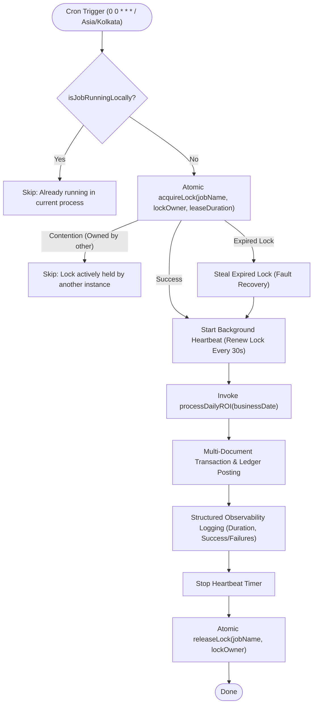

# NexaChain – Automated Daily ROI Scheduler & Distributed Lock Architecture

This document describes the architectural specifications, distributed locking mechanisms, multi-instance concurrency protections, failure recovery workflows, and operational instructions governing the **Automated Daily ROI Scheduler** in NexaChain.

---

## 1. Scheduler Overview & Architecture

The Automated Scheduler ([`backend/src/cron/dailyRoiJob.js`](file:///c:/all_assesments/nexaChain/backend/src/cron/dailyRoiJob.js)) is powered by `node-cron` and executes daily at midnight (12:00 AM) in the canonical business timezone (`Asia/Kolkata`).

To prevent split-brain execution across multiple horizontal application replicas (e.g. Kubernetes pods, PM2 cluster workers), execution is guarded by a MongoDB-backed **Distributed Lock Service** ([`backend/src/services/jobLockService.js`](file:///c:/all_assesments/nexaChain/backend/src/services/jobLockService.js)).



---

## 2. Technical Configuration & Environment Knobs

All scheduling and locking parameters are centralized in [`backend/src/config/cronConfig.js`](file:///c:/all_assesments/nexaChain/backend/src/config/cronConfig.js):

| Parameter | Environment Variable | Default Value | Description |
|---|---|---|---|
| `isEnabled` | `CRON_ENABLED` | `true` in prod/dev; `false` in test | Master switch to enable or disable the background cron task in this process. |
| `cronExpression` | `CRON_SCHEDULE` | `'0 0 * * *'` | Standard 5-field cron expression (12:00 AM daily). |
| `timeZone` | `CRON_TIMEZONE` | `'Asia/Kolkata'` | Canonical business calendar timezone (UTC+05:30). |
| `jobName` | N/A | `'DAILY_ROI_PROCESSING'` | Unique identifier used for MongoDB distributed lock records. |
| `lockLeaseDurationMs` | `CRON_LOCK_LEASE_MS` | `600000` (10 min) | Duration before a lock is deemed abandoned/expired. |
| `lockHeartbeatIntervalMs` | `CRON_HEARTBEAT_MS` | `30000` (30 sec) | Interval at which an active job refreshes its lock lease. |

> [!NOTE]
> **Separation of Concerns**: Technical scheduling parameters (cron intervals, timeouts, heartbeat) are strictly decoupled from financial business rules (ROI rates, plan registry, wallet crediting).

---

## 3. Distributed Locking Mechanism (`job_locks`)

To safely support horizontal scaling without duplicate financial payouts:

### 1. Data Schema
The `job_locks` collection stores:
- `jobName`: Unique string identifier (index: `{ jobName: 1 }, { unique: true }`).
- `lockOwner`: Identifier combining hostname, PID, and random cryptographic bytes (`host-pid-rand`).
- `acquiredAt`: Timestamp of initial lock grant.
- `expiresAt`: Expiration timestamp (indexed).
- `lastHeartbeatAt`: Timestamp of the most recent heartbeat lease extension.

### 2. Atomic Acquisition Algorithm
Acquisition executes atomically via MongoDB:
```javascript
// Step 1: Attempt to atomically update an expired lock or extend own lock
const updated = await JobLock.findOneAndUpdate(
  {
    jobName,
    $or: [
      { expiresAt: { $lte: now } },
      { lockOwner }
    ]
  },
  {
    $set: { lockOwner, acquiredAt: now, expiresAt: newExpiresAt, lastHeartbeatAt: now }
  },
  { new: true }
);

// Step 2: If no existing document, atomically insert (guarded by unique index)
if (!updated) {
  try {
    await JobLock.create({ jobName, lockOwner, expiresAt: newExpiresAt });
  } catch (err) {
    if (err.code === 11000) return { acquired: false }; // Competing instance won
  }
}
```

### 3. Fault Recovery
- If an instance crashes mid-execution (SIGKILL, hardware failure), its lock expires after `lockLeaseDurationMs`.
- The subsequent cron cycle or manual trigger automatically steals the expired lock and resumes processing without manual database intervention.

### 4. Safe Release & Owner Isolation
An instance can **only release locks that it owns**:
```javascript
await JobLock.deleteOne({ jobName, lockOwner });
```
This prevents an instance whose lock expired due to a network partition from releasing a lock acquired by a newer, healthy instance.

---

## 4. Idempotency & Partial Crash Recovery

The daily ROI engine is completely idempotent and safe against mid-run crashes:
1. **Per-Investment Atomic Transactions**: Each investment payout executes in an isolated transaction.
2. **Compound Unique Index**: `ROIHistory` enforces `{ investment: 1, businessDate: 1 }, { unique: true }`.
3. **Crash Recovery**: If an instance crashes after processing 50 out of 100 investments:
   - The first 50 committed investments remain valid and credited.
   - When the job is re-run (or retried by another node), the query finds all eligible investments, checks `ROIHistory.findOne({ investment, businessDate })`, immediately skips the 50 already-committed records, and processes the remaining 50.
   - **Zero double crediting or duplicate ledger rows can occur.**

---

## 5. Structured Observability Logging

Every scheduled or manual run outputs structured execution logs:

```json
{
  "jobName": "DAILY_ROI_PROCESSING",
  "businessDate": "2026-11-03",
  "instanceId": "server-node-1-8492-4f3b1a2c",
  "startTimestamp": "2026-11-03T18:30:00.000Z",
  "completionTimestamp": "2026-11-03T18:30:01.240Z",
  "durationMs": 1240,
  "jobStatus": "SUCCESS",
  "eligibleInvestments": 150,
  "processedInvestments": 150,
  "skippedInvestments": 0,
  "failedInvestments": 0,
  "totalRoiGeneratedPaise": 225000,
  "failures": []
}
```

- **Status Values**:
  - `SUCCESS`: All eligible investments processed without error.
  - `PARTIAL_FAILURE`: Some investments encountered validation/rate mismatches and were logged in `failures`.
  - `FAILED`: Execution aborted due to system/database error.
  - `SKIPPED_LOCK_HELD_BY_ANOTHER_INSTANCE`: Normal multi-instance coordination skip.
  - `SKIPPED_ALREADY_RUNNING_LOCALLY`: Prevented overlapping run within same process.

> [!SECURITY]
> **Data Privacy**: Logs strictly contain metrics, timestamps, and contract IDs. Passwords, JWTs, emails, and sensitive user data are never logged.

---

## 6. Server Lifecycle & Graceful Shutdown (`server.js`)

1. **Startup Sequence**:
   - Step 1: Connect to MongoDB via Mongoose.
   - Step 2: Bind Express HTTP server to `PORT`.
   - Step 3: Start `startDailyRoiScheduler()` only after database is operational.
2. **Graceful Shutdown (`SIGINT`, `SIGTERM`)**:
   - Step 1: Call `stopDailyRoiScheduler()` to halt future cron ticks.
   - Step 2: Call `releaseLock('DAILY_ROI_PROCESSING', instanceIdentifier)` to unblock other nodes.
   - Step 3: Close HTTP server (stops receiving new HTTP requests).
   - Step 4: Disconnect MongoDB connection cleanly via `disconnectDB()`.

---

## 7. Disabling Scheduling in Development & Tests

- **In Unit / Integration Tests**:
  By default, `NODE_ENV=test` automatically disables automatic scheduling (`isEnabled: false`). Tests invoke `executeDailyRoiJob()` deterministically.
- **In Local Development**:
  To run the backend server without background cron triggers:
  ```env
  CRON_ENABLED=false
  ```
- **In Multi-Instance Kubernetes Deployments**:
  All pods can safely leave `CRON_ENABLED=true` because the distributed lock guarantees that only one pod executes the job at midnight.

