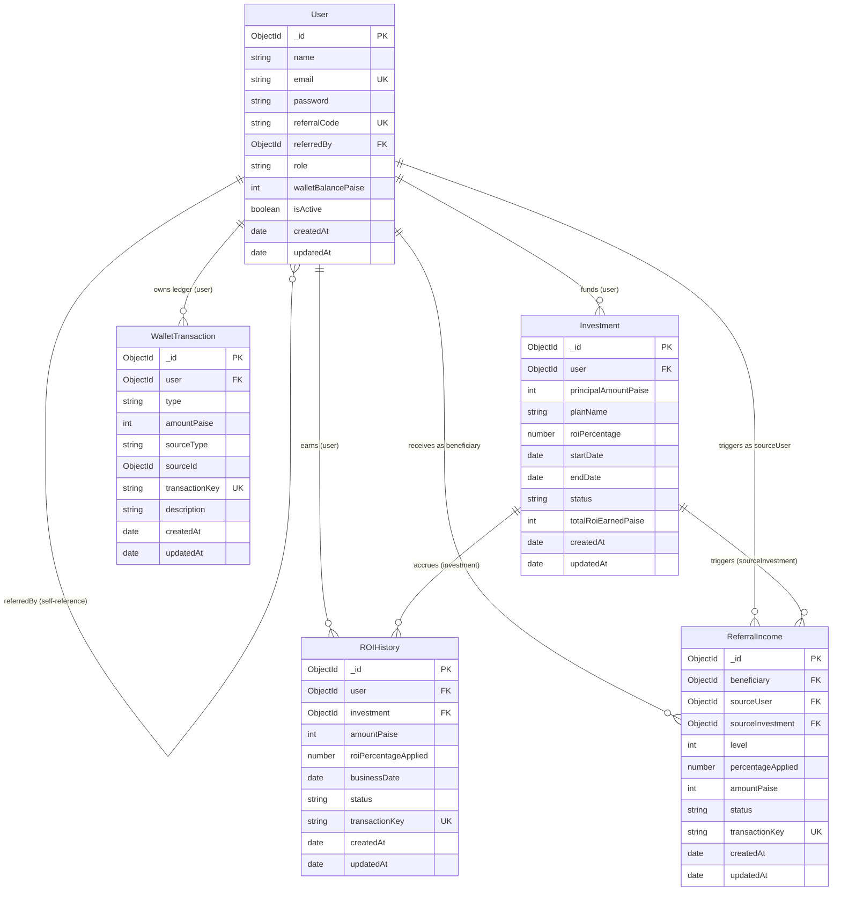

# NexaChain – Database Architecture & Data Models

## 1. Overview

The NexaChain database design uses MongoDB with Mongoose ODM to model an investment and multi-tier referral management platform. The schema structure adheres to financial data modeling standards:
- **Strict Referential Integrity:** Foreign keys modeled through `mongoose.Schema.Types.ObjectId`.
- **Zero Floating-Point Drift:** All monetary amounts are recorded in integer **paise** ($1\text{ INR} = 100\text{ paise}$).
- **Idempotency & Deduplication:** Compound unique indexes and unique transaction keys guarantee that daily ROI runs and referral payouts cannot be recorded more than once.

---

## 2. Entity-Relationship Diagram (Mermaid)



---

## 3. Relationships and References

### 1. One User to Many Investments (`User 1:N Investment`)
- A user can create and hold multiple active or historical investment packages.
- Each `Investment` document stores `user: ObjectId (ref: 'User')`.
- Fast lookup enabled via `{ user: 1, status: 1 }` index.

### 2. One Investment to Many ROI History Records (`Investment 1:N ROIHistory`)
- An investment yields recurring daily or periodic ROI distributions throughout its active lifecycle.
- Each `ROIHistory` document links to its parent investment via `investment: ObjectId (ref: 'Investment')`.
- Also references `user: ObjectId (ref: 'User')` for direct aggregation of user earnings.

### 3. One User to Many Referred Users (`User 1:N User` Self-Referential Tree)
- Platform users invite other users using their unique `referralCode`.
- A referred user stores the inviter's `_id` in `referredBy: ObjectId (ref: 'User')`.
- Validation strictly forbids self-referral (`this._id !== this.referredBy`).
- Traversing `referredBy` allows reconstruction of multi-tier upline sponsor hierarchies.

### 4. One User to Many Referral Incomes (`User 1:N ReferralIncome`)
- When a downline user makes an investment, eligible upline users receive referral commissions based on their generational tier (`level`).
- `beneficiary: ObjectId (ref: 'User')`: The upline member who earns the commission.
- `sourceUser: ObjectId (ref: 'User')`: The downline member whose investment generated the reward.
- `sourceInvestment: ObjectId (ref: 'Investment')`: The exact investment contract linked to this commission.

### 5. One User to Many Wallet Transactions (`User 1:N WalletTransaction`)
- The wallet transaction collection acts as an immutable double-entry ledger.
- Records all credits (`roi`, `referral`, `adjustment`) and debits (`investment`, `withdrawal`).
- Links to parent user via `user: ObjectId (ref: 'User')` with compound index `{ user: 1, createdAt: -1 }`.

---

## 4. Architectural Design Decisions

### Integer Paise for Monetary Amounts
- **The Problem:** JavaScript `Number` represents values using IEEE-754 double-precision floating-point format. Floating-point math introduces fractional representation errors (e.g. `0.1 + 0.2 === 0.30000000000000004`). In financial platforms, fractional errors compound over thousands of daily transactions into balance discrepancies.
- **The Solution:** All monetary fields (`walletBalancePaise`, `principalAmountPaise`, `amountPaise`, `totalRoiEarnedPaise`) are stored as strictly validated **non-negative integers representing paise**.
- Example: ₹1,000.50 is stored as `100050`. ₹500 is stored as `50000`. Conversion to display rupees is performed at the UI formatting boundary only.

### Compound Unique Indexes for Payout Deduplication
- **The Problem:** In automated cron jobs or distributed worker systems, network retries or concurrent cron execution can trigger multiple ROI payouts for the same investment on the same calendar day.
- **The Solution:** `ROIHistory` enforces a database-level compound unique index:
  ```javascript
  roiHistorySchema.index({ investment: 1, businessDate: 1 }, { unique: true });
  ```
  `businessDate` is normalized to UTC midnight (`00:00:00.000Z`). Even if a cron job runs repeatedly on the same day, MongoDB rejects duplicate insertions with error code `11000` (E11000 duplicate key error).

### Idempotency Keys (`transactionKey`)
- Both `ReferralIncome`, `ROIHistory`, and `WalletTransaction` maintain a unique string `transactionKey`.
- Formatted deterministically (e.g. `roi_<investmentId>_<YYYY-MM-DD>` or `ref_<beneficiaryId>_<sourceInvestmentId>_lvl<N>`).
- Guarantees end-to-end idempotency across retry attempts.

