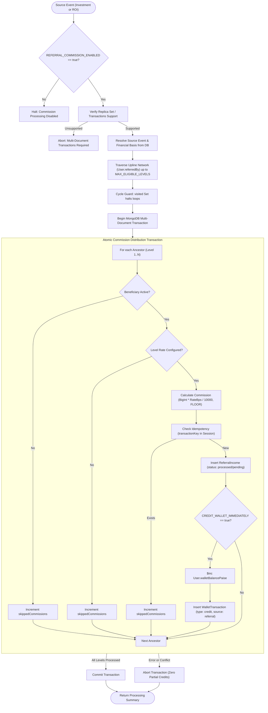

# NexaChain – Multi-Level Referral Commission Engine Architecture

This document describes the architectural specifications, mathematical formulations, transactional integrity rules, idempotency models, and administrative controls governing the **Multi-Level Referral Commission Engine** in NexaChain.

---

## 1. Engine Overview & Architecture

The Referral Commission Engine operates as an idempotent, transaction-safe service layer ([`backend/src/services/referralCommissionService.js`](file:///c:/all_assesments/nexaChain/backend/src/services/referralCommissionService.js)) capable of evaluating multi-generational uplines, computing basis-point commissions, and crediting beneficiary ledgers atomically.



---

## 2. Configuration & Business Rules (`backend/src/config/referralCommissionConfig.js`)

All commission operations are governed by centralized business rules that refuse execution if mandatory parameters are missing or unapproved.

### Technical Defaults vs Business Rules
The engine strictly isolates operational parameters from financial rules:

| Configuration Parameter | Type | Default Value | Category | Description |
|---|---|---|---|---|
| `IS_ENABLED` | Boolean | `false` | Business Rule | Master safety switch. Commission processing is disabled by default until approved by stakeholders. |
| `TRIGGER_EVENT` | Enum | `null` | Business Rule | Supported trigger options: `'INVESTMENT_ACTIVATION'` or `'ROI_PAYOUT'`. |
| `CALCULATION_BASIS` | Enum | `null` | Business Rule | Supported bases: `'INVESTMENT_PRINCIPAL'` or `'ROI_AMOUNT'`. |
| `MAX_ELIGIBLE_LEVELS` | Integer | `null` | Business Rule | Maximum upline generations eligible for commission distribution (e.g. 3, 5). |
| `LEVEL_RATES_BPS` | Object | `null` | Business Rule | Key-value mapping of level to basis points (e.g. `{"1": 500, "2": 300, "3": 100}`). |
| `ROUNDING_MODE` | Enum | `'FLOOR'` | Business Rule | Rounding policy for fractional paise (`'FLOOR'`, `'ROUND'`, `'CEIL'`). |
| `CREDIT_WALLET_IMMEDIATELY` | Boolean | `true` | Business Rule | When true, updates `user.walletBalancePaise` and writes a `WalletTransaction` atomically. When false, persists `ReferralIncome` as `'pending'`. |
| `REQUIRE_ACTIVE_BENEFICIARY` | Boolean | `true` | Business Rule | Requires beneficiary accounts to have `isActive: true`. Suspended members are skipped. |
| `ELIGIBLE_SOURCE_STATUSES` | Array | `['active', 'completed', 'processed']` | Business Rule | Allowed statuses for source contracts/payouts. |
| `MAX_TRAVERSAL_GUARD` | Integer | `20` | Technical Knob | Hard recursion ceiling to protect node memory from deep tree graphs. |

> [!CAUTION]
> **No Assumed Defaults**: The engine never invents commission percentages, tier counts, or trigger events. Missing, unapproved, or contradictory configuration immediately halts processing with an explicit Configuration Error.

---

## 3. Mathematical Formula & Monetary Precision

### Basis Point Representation
To avoid floating-point inaccuracies, commission rates are represented strictly as **integer basis points (bps)**:
- $1\% = 100\text{ bps}$
- $1.5\% = 150\text{ bps}$
- $5\% = 500\text{ bps}$
- $10\% = 1,000\text{ bps}$
- $100\% = 10,000\text{ bps}$

### Exact Mathematical Formula
$$\text{Numerator} = \text{BigInt}(\text{BasisAmountPaise}) \times \text{BigInt}(\text{RateBasisPoints})$$

$$\text{Quotient} = \lfloor \frac{\text{Numerator}}{10000} \rfloor, \quad \text{Remainder} = \text{Numerator} \pmod{10000}$$

$$\text{CommissionPaise} = \begin{cases} 
\text{Quotient} & \text{if RoundingMode is FLOOR (default)} \\
\text{Quotient} + 1 & \text{if RoundingMode is ROUND and Remainder} \ge 5000 \\
\text{Quotient} + 1 & \text{if RoundingMode is CEIL and Remainder} > 0 
\end{cases}$$

### Illustrative Numerical Calculations (FLOOR mode)
| Principal Basis | Level | Rate BPS | Rate % | Exact Fractional Paise | Persisted Commission |
|---|---|---|---|---|---|
| ₹10,000.00 (`1000000` paise) | Level 1 | `500` bps | 5.0% | `50000.0` | **`50000` paise** (₹500.00) |
| ₹10,000.00 (`1000000` paise) | Level 2 | `300` bps | 3.0% | `30000.0` | **`30000` paise** (₹300.00) |
| ₹10,000.00 (`1000000` paise) | Level 3 | `100` bps | 1.0% | `10000.0` | **`10000` paise** (₹100.00) |
| ₹0.75 (`75` paise) | Level 1 | `500` bps | 5.0% | `3.75` | **`3` paise** (₹0.03) |
| ₹100,000,000.00 (`10^10` paise) | Level 1 | `750` bps | 7.5% | `750000000.0` | **`750000000` paise** (₹7.5M) |

---

## 4. Referral Chain Traversal & Cycle Protection

The traversal engine ([`traverseReferralAncestors`](file:///c:/all_assesments/nexaChain/backend/src/services/referralCommissionService.js)) traverses upwards through the `User.referredBy` hierarchy:
1. **Level 1**: The direct sponsor (`sourceUser.referredBy`).
2. **Level 2**: The direct sponsor's sponsor (`level1User.referredBy`).
3. **Level N**: Recursion continues until `N === MAX_ELIGIBLE_LEVELS` or no further ancestor exists.
4. **Cycle Immunity**: Maintains an internal `visited = new Set([sourceUser._id.toString()])`. If any ancestor ID was previously seen, traversal halts immediately, preventing infinite loops on corrupted data.
5. **Beneficiary Eligibility**: Inactive accounts (`isActive: false`) are marked ineligible and skipped without breaking the upline traversal chain for higher levels.

---

## 5. Financial Transaction Consistency & Rollback

Multi-tier commission distribution operates under **all-or-nothing atomicity** using MongoDB multi-document transactions:

```javascript
const session = await mongoose.startSession();
session.startTransaction();
try {
  for (const ancestor of ancestors) {
    await refIncomeDoc.save({ session });
    if (config.CREDIT_WALLET_IMMEDIATELY) {
      await User.findByIdAndUpdate(ancestor._id, { $inc: { walletBalancePaise } }, { session });
      await walletTxDoc.save({ session });
    }
  }
  await session.commitTransaction();
} catch (error) {
  await session.abortTransaction(); // Zero partial commissions
}
```

- **Prevention of Partial Credits**: If Level 1 and Level 2 succeed, but Level 3 encounters a database error, the transaction aborts completely. No partial commission records or unbacked wallet balance changes remain.
- **Source User Isolation**: The source user whose transaction triggered the event never receives a commission unless they are also a distinct upline sponsor.

---

## 6. Deterministic Idempotency & Concurrency Safety

1. **Unique Transaction Keys**:
   - For `INVESTMENT_ACTIVATION`: `ref_inv_<sourceInvestmentId>_ben_<beneficiaryId>_lvl<level>`
   - For `ROI_PAYOUT`: `ref_roi_<roiHistoryId>_ben_<beneficiaryId>_lvl<level>`
   - For `WalletTransaction`: `wallet_<refTransactionKey>`
2. **Unique Compound Constraints**:
   - Enforced by `ReferralIncome.transactionKey` (`unique: true`).
   - Query index on `{ sourceInvestment: 1, beneficiary: 1, level: 1 }`.
3. **Race Condition Safety**:
   Concurrent execution attempts for the exact same source event are serialized by MongoDB document locks. Competing transactions fail with `E11000` duplicate key or `WriteConflict` errors, aborting cleanly and safely reporting `commissionsSkipped` without double crediting balances.

---

## 7. Integration with Daily ROI Processing

- When `TRIGGER_EVENT === 'ROI_PAYOUT'`:
  [`processDailyROI`](file:///c:/all_assesments/nexaChain/backend/src/services/roiService.js) invokes [`processRoiReferralCommissionsInSession`](file:///c:/all_assesments/nexaChain/backend/src/services/referralCommissionService.js) inside the active session transaction. The daily ROI payout and all associated upline referral commissions commit atomically.
- When `TRIGGER_EVENT === 'INVESTMENT_ACTIVATION'`:
  Commissions are decoupled from daily ROI and processed via the investment activation service/API.
- When `IS_ENABLED === false` (Production Default):
  Referral commission processing safely no-ops, preserving the standard daily ROI execution without interference.

---

## 8. Business Decisions Still Requiring Stakeholder Approval

| Business Decision | Current System Capability | Approval Required from Stakeholders |
|---|---|---|
| **Commission Trigger Event** | Supports `INVESTMENT_ACTIVATION` or `ROI_PAYOUT` | Confirm whether commissions should trigger on one-time investment activation or recurring daily ROI payouts. |
| **Calculation Financial Basis** | Supports `INVESTMENT_PRINCIPAL` or `ROI_AMOUNT` | Confirm whether commissions are calculated on principal deposited or daily yield generated. |
| **Generational Commission Tiers** | Configurable via basis points per tier | Confirm the exact commission percentages and eligible depth (e.g. 3 tiers: 5%, 3%, 1% vs 5 tiers). |
| **Minimum Personal Investment Rule** | Currently checks `isActive: true` only | Confirm whether an upline sponsor must hold an active investment themselves to qualify for downline commissions. |
| **Immediate vs Held Wallet Crediting** | Configurable boolean | Confirm whether referral commissions should be immediately spendable or placed in escrow for withdrawal clearance. |
