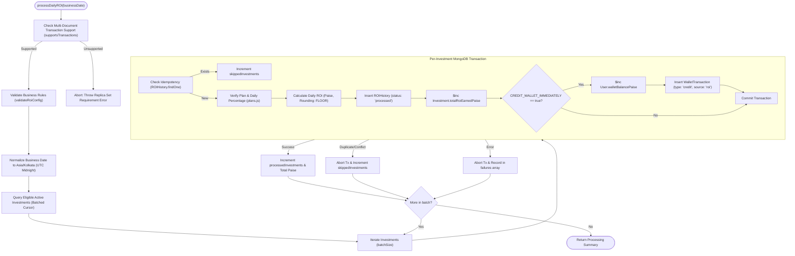

# NexaChain – Daily ROI Processing Engine & Financial Architecture

This document describes the architectural specifications, mathematical formulas, transactional consistency model, idempotency guarantees, and operational procedures governing the **Daily Return on Investment (ROI) Processing Engine** in NexaChain.

---

## 1. Engine Overview & Architecture

The Daily ROI Processing Engine operates as a decoupled, idempotent, transaction-safe service layer ([`backend/src/services/roiService.js`](file:///c:/all_assesments/nexaChain/backend/src/services/roiService.js)). It can be triggered programmatically by scheduled automation tasks (e.g. cron workers) or administratively via authorized endpoints without being coupled to HTTP request lifecycles.



---

## 2. Configuration & Business Rules (`backend/src/config/roiConfig.js`)

All ROI operations are governed by centralized business rules that refuse execution if mandatory parameters are missing or invalid:

| Parameter | Type | Default Value | Category | Description |
|---|---|---|---|---|
| `TIMEZONE` | String | `'Asia/Kolkata'` | Business Rule | Standard business calendar timezone for normalizing calendar days. |
| `CALCULATION_MODE` | String | `'DAILY_SIMPLE'` | Business Rule | Daily simple interest based on active principal amount. |
| `ALLOWED_INVESTMENT_STATUSES` | Array | `['active']` | Business Rule | Only active contracts generate returns. Pending, completed, and cancelled are excluded. |
| `ROUNDING_MODE` | String | `'FLOOR'` | Business Rule | Policy for handling fractional paise (`'FLOOR'`, `'ROUND'`, `'CEIL'`). |
| `CREDIT_WALLET_IMMEDIATELY` | Boolean | `true` | Business Rule | When true, credits `user.walletBalancePaise` and writes a `WalletTransaction` atomically. |
| `PLANS` | Object | `INVESTMENT_PLANS` | Business Rule | Authoritative server-side plan registry defining approved daily ROI percentages. |
| `BATCH_SIZE` | Integer | `100` | Technical Knob | Cursor limit per database batch to maintain low heap and network footprint. |
| `MAX_BATCH_SIZE` | Integer | `500` | Technical Knob | Upper safety ceiling for batch processing. |

> [!IMPORTANT]
> **Strict Business Rule Guard**: The engine explicitly separates technical knobs from business rules. The configuration validator (`validateRoiConfig`) throws hard exceptions if business rules are absent, corrupted, or forged. It **never silently substitutes default percentages**.

---

## 3. Mathematical Formula & Monetary Precision

Monetary integrity is preserved using **integer paise** (₹1.00 = 100 paise) across all calculations, schemas, and persistence operations.

### Daily Calculation Formula
$$\text{RawROI}_{\text{paise}} = \frac{\text{principalAmountPaise} \times \text{roiPercentage}}{100}$$

$$\text{FinalROI}_{\text{paise}} = \lfloor \text{RawROI}_{\text{paise}} \rfloor \quad (\text{under default FLOOR rounding})$$

### Rounding Policy Comparison
| Principal | Daily ROI % | Exact Fractional Paise | `FLOOR` (Default) | `ROUND` | `CEIL` |
|---|---|---|---|---|---|
| ₹1,000.00 (`100000` paise) | `1.5%` | `1500.0` | **`1500`** (₹15.00) | `1500` | `1500` |
| ₹500.00 (`50000` paise) | `1.0%` | `500.0` | **`500`** (₹5.00) | `500` | `500` |
| ₹0.75 (`75` paise) | `1.0%` | `0.75` | **`0`** (₹0.00) | `1` (₹0.01) | `1` (₹0.01) |
| ₹150.25 (`15025` paise) | `1.5%` | `225.375` | **`225`** (₹2.25) | `225` | `226` (₹2.26) |

> [!TIP]
> **Why `FLOOR` Mode is Standard**: Truncating fractional paise guarantees solvency for the platform by preventing fractional penny inflation (creating unbacked paise over millions of daily records).

---

## 4. Investment Eligibility Boundaries

An investment contract is eligible for ROI accrual on a given `businessDate` if and only if **all** of the following conditions are satisfied:
1. **Status Boundary**: `investment.status === 'active'`. Pending, completed, and cancelled investments are strictly ignored.
2. **Start-Date Boundary**: `investment.startDate <= endOfBusinessDay` (investment was active on or before the calendar business date; future contracts are excluded).
3. **End-Date Boundary**: `investment.endDate === null || investment.endDate >= startOfBusinessDay` (contracts that expired prior to the business date are excluded).
4. **Plan Integrity**: `investment.planName` exists in `INVESTMENT_PLANS` and `investment.roiPercentage === serverPlan.roiPercentage`. Forged or mismatched rates are quarantined into `failures` without aborting other investments.

---

## 5. Transaction Safety & Replica Set Requirement

Financial operations across the four impacted collections (`roi_histories`, `investments`, `users`, `wallet_transactions`) are executed inside **MongoDB Multi-Document Atomic Transactions** via Mongoose sessions.

### Transaction Operations
```javascript
// Step 1: Write ROI History record
await roiDoc.save({ session });

// Step 2: Increment cumulative ROI earned on Investment
await Investment.findByIdAndUpdate(investment._id, { $inc: { totalRoiEarnedPaise: roiAmountPaise } }, { session });

// Step 3: Increment user wallet balance
await User.findByIdAndUpdate(investment.user, { $inc: { walletBalancePaise: roiAmountPaise } }, { session });

// Step 4: Write immutable double-entry wallet ledger entry
await walletTx.save({ session });
```

### Rollback Guarantee
If an unexpected crash, validation error, or database timeout occurs during any step, `session.abortTransaction()` is invoked immediately. No partial balance credit, orphaned ROI history, or mismatched cumulative totals can ever be committed to the database.

### MongoDB Standalone vs Replica Set
- Multi-document transactions require a MongoDB **Replica Set** (`rs0`) or **Sharded Cluster**.
- If executed against a standalone MongoDB instance, `supportsTransactions()` returns `false` and the engine halts immediately with a clear error:
  ```text
  MongoDB deployment does not support multi-document transactions. ROI processing requires a replica set or sharded cluster to ensure atomic financial updates across ROI history, investments, user balances, and ledger transactions.
  ```
- **Local Development / Docker Configuration**:
  To enable a single-node replica set locally:
  ```bash
  mongod --replSet rs0 --dbpath <data-dir>
  # In mongosh:
  rs.initiate()
  ```

---

## 6. Idempotency & Concurrency Guarantees

The platform protects against duplicate payouts via 3 redundant layers:

1. **Deterministic Unique Keys**:
   - `ROIHistory.transactionKey`: `roi_<investmentId>_<YYYY-MM-DD>`
   - `WalletTransaction.transactionKey`: `wallet_roi_<investmentId>_<YYYY-MM-DD>`
2. **Compound Unique Database Index**:
   ```javascript
   roiHistorySchema.index({ investment: 1, businessDate: 1 }, { unique: true });
   ```
3. **Race Condition Immunity**:
   If two worker processes execute `processDailyROI` simultaneously for the same business date:
   - One worker commits successfully.
   - The competing worker encounters a `code: 11000` duplicate key or `WriteConflict` error inside its transaction.
   - The transaction aborts cleanly, and the second worker safely increments `skippedInvestments` without double crediting the user's wallet.

---

## 7. Business Decisions Needing Company Confirmation

| Assumption / Decision | Current Working Implementation | Company Confirmation Needed |
|---|---|---|
| **Immediate vs Claimed Wallet Crediting** | Immediately credited to `user.walletBalancePaise` | Confirm whether daily ROI should be immediately spendable, or credited to an escrow/locked balance awaiting maturity or manual claim. |
| **Duration Maturity / Completion Lifecycle** | Investment remains `'active'` unless manually updated or past `endDate` | Confirm whether an investment whose `endDate` is reached should automatically transition to `status: 'completed'` and return principal to wallet. |
| **Simple vs Compounding ROI** | Daily simple interest on initial `principalAmountPaise` | Confirm whether any VIP or high-yield tiers offer daily compounding (reinvestment of accrued ROI into principal). |
| **Weekend / Holiday Accruals** | Accrues 7 days per week (365 days/year) | Confirm whether ROI runs daily or excludes bank holidays / non-trading weekends. |
| **Minimum Accrual Threshold** | Truncates below 1 paise (`Math.floor`) | Confirm whether investments producing `< 1 paise` daily should accumulate fractional balances in an internal balance buffer. |

