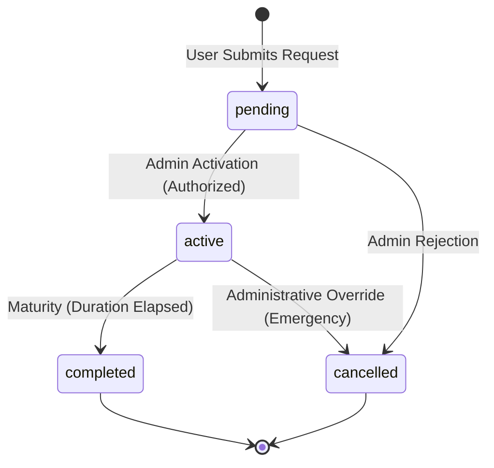

# NexaChain — Investment Request Lifecycle Architecture & Security Audit

**Document Reference:** `docs/INVESTMENT_LIFECYCLE_AUDIT.md`  
**Assessment Milestone:** Milestone 2: Complete Investment Request Lifecycle  
**Author:** Principal Full-Stack Engineer & Financial Systems Auditor  
**Date:** November 2026  
**Status:** Complete Architectural Specification & Audit

---

## 1. Executive Summary

This document establishes the authoritative architectural baseline, security review, state machine specifications, and remediation roadmap for the **Investment Request Lifecycle** in NexaChain.

Prior to Milestone 2, the NexaChain backend supported initial creation of investment contracts via `POST /api/investments`, persisting them with `pending` status. However, the user-facing investment views (`/investments`, `/investments/:id`) were strictly read-only with no interface for capital allocation or package selection. Crucially, the platform lacked an administrative activation workflow, meaning submitted packages remained indefinitely in `pending` state with no mechanism to transition into an `active` state for daily return accrual.

Furthermore, the existing investment packages (`STARTER` at 1.0%/30d, `GROWTH` at 1.5%/60d, `PREMIUM` at 2.0%/90d) represent **unapproved illustrative technical defaults** introduced for testing and architectural verification. To maintain financial safety and regulatory solvency, administrative package activation must be protected by an authoritative production safety gate (`INVESTMENT_ACTIVATION_ENABLED=false` by default) until commercial terms are formally ratified.

---

## 2. Current Architecture & API Contracts

### 2.1 Mongoose Investment Data Model (`backend/src/models/Investment.js`)

The existing schema enforces strict integer-paise precision and account ownership:

```javascript
{
  user: { type: ObjectId, ref: 'User', required: true, index: true },
  principalAmountPaise: { type: Number, required: true, integer >= 0 },
  planName: { type: String, required: true, trim: true },
  roiPercentage: { type: Number, required: true, min: 0 },
  startDate: { type: Date, required: true, default: Date.now, index: true },
  endDate: { type: Date, default: null },
  status: {
    type: String,
    enum: ['pending', 'active', 'completed', 'cancelled'],
    default: 'pending',
    index: true
  },
  totalRoiEarnedPaise: { type: Number, default: 0, integer >= 0 }
}
```

*Indexes:* Single field indexes on `user`, `status`, `startDate`; compound index on `{ user: 1, status: 1 }`.

**Gaps Identified in Data Model:**
- Missing administrative audit fields: `actionedBy` (ObjectId ref User), `actionedAt` (Date), and `rejectionReason` (String). Without these fields, administrative approvals and rejections lack non-repudiation and auditability.

### 2.2 Server Plan Registry (`backend/src/config/plans.js`)

The backend maintains an in-memory plan registry:
- `STARTER`: 1.0% daily return, 30 days duration.
- `GROWTH`: 1.5% daily return, 60 days duration.
- `PREMIUM`: 2.0% daily return, 90 days duration.

Functions provided: `findPlan(identifier)`, `getAvailablePlanNames()`.

**Gaps Identified in Plan Configuration:**
- There is no public or authenticated API endpoint to expose authorized plans to the frontend (`GET /api/investments/plans`). The frontend has to hardcode plans or cannot load dynamic server rates.
- Rates and durations are illustrative seed values rather than commercial policies.

### 2.3 Existing Backend API Endpoints (`investmentRoutes.js`)

| HTTP Method | Route | Auth / Role | Current Behavior |
| :--- | :--- | :--- | :--- |
| `POST` | `/api/investments` | Authenticated (`user`) | Validates `principalAmountPaise` and `planName`. Resolves plan from `plans.js`. Persists investment with `status: 'pending'`, `totalRoiEarnedPaise: 0`. Rate is server-authoritative. |
| `GET` | `/api/investments` | Authenticated (`user`) | Retrieves paginated investments scoped exclusively to `req.user._id`. Supports query parameters `page`, `limit`, `status`. Sorted newest-first (`createdAt: -1`). |
| `GET` | `/api/investments/:id` | Authenticated (`user`) | Retrieves specific investment if `_id === req.params.id` AND `user === req.user._id`. Returns 404 if not found or unauthorized. |

### 2.4 Frontend Investment State & User Interface

- **RTK Query (`investmentApi.js`):** Defines `createInvestment`, `getInvestments`, `getInvestmentById`, `getInvestmentPlans`, `getAdminPendingInvestments`, `activateInvestment`, and `rejectInvestment`.
- **Investments Page (`InvestmentsPage.jsx`):** Renders overview cards, status filter tabs, desktop table, mobile cards, pagination, "Create Investment" modal action, and status guide.
- **Admin Review Page (`AdminInvestmentsPage.jsx`):** Admin-only workspace for inspecting pending requests, reviewing applicant verification details, confirming activations, and rejecting requests with audit explanations.
- **Detail Page (`InvestmentDetailPage.jsx`):** Renders specifications, lifecycle status, audit timestamps, and principal/ROI cards. Scoped to authenticated user.

### 2.5 Investment Funding & Wallet Ledger Semantics (Authoritative Audit)

A rigorous trace of `POST /api/investments` and `investmentService.createInvestment()` reveals the following authoritative financial behaviors:

| Operational Dimension | System Reality | Architectural Justification |
| :--- | :--- | :--- |
| **Is the wallet debited?** | **NO** | `createInvestment` only inserts a row into the `investments` collection. It does not update `User.walletBalancePaise`. |
| **Is an amount reserved?** | **NO** | The `User` data model does not contain an escrow or reserved balance field. |
| **Is there a ledger entry?** | **NO** | No row is written to `WalletTransaction` upon request submission. `WalletTransaction` rows are strictly generated upon actual financial movements (such as daily ROI distributions). |
| **Can a user submit without wallet funds?** | **YES** | The submission represents an **application of intent / capital allocation request** awaiting administrative verification and offline settlement or funding. |
| **What happens upon administrative rejection?** | **Status $\rightarrow$ `cancelled`** | No wallet refund or ledger reversal is executed, because no funds were debited or locked at submission. The rejection explanation is logged to `rejectionReason`. |

> [!IMPORTANT]
> **Product Labeling Mandate:** The frontend user interface explicitly labels new investment submissions as **"Investment Requests (Unfunded / Awaiting Administrative Review & Verification)"**. Under no circumstances does the platform imply that funds have been transferred or deducted prior to formal administrative processing and contract activation.

---

## 3. Investment Statuses & State Machine Transitions

### 3.1 Status Definitions

The system models four discrete investment states:



1. **`pending` (Initial State):**
   - **Semantics:** Investment request has been registered and verified by the server. Capital commitment is logged, but the contract has not been countersigned or activated by platform administrators.
   - **Financial Rules:** **Strictly excluded from daily ROI calculation batch jobs.** Zero yield accrues while in pending status.
2. **`active` (Operating State):**
   - **Semantics:** Contract is authorized and operational.
   - **Financial Rules:** Eligible for automated daily ROI calculation at 00:00 IST (`Asia/Kolkata`). Yield is credited to `User.walletBalancePaise` and logged in `ROIHistory` and `WalletTransaction`.
3. **`completed` (Terminal Matured State):**
   - **Semantics:** Contract has reached its full calendar maturity (`endDate < startOfBusinessDay`).
   - **Financial Rules:** No further ROI accrues. Principal remains recorded for historical audit.
4. **`cancelled` (Terminal Inactive State):**
   - **Semantics:** Request was rejected by administration prior to activation, or administratively voided.
   - **Financial Rules:** Excluded from all future ROI runs. Rejection reason is recorded in audit metadata.

### 3.2 State Transition Matrix & Transition Guards

| Current State | Target State | Permitted Actor | Authorization & Guards | Resulting Side Effects |
| :--- | :--- | :--- | :--- | :--- |
| `[None]` | `pending` | Authenticated User | Valid `principalAmountPaise > 0`, recognized server plan. | Creates record; `status: 'pending'`, `totalRoiEarnedPaise: 0`. |
| `pending` | `active` | Admin Only (`role: 'admin'`) | 1. `INVESTMENT_ACTIVATION_ENABLED === true`<br>2. Admin `_id !== investment.user` (Self-approval forbidden)<br>3. Status must currently be `pending` | Sets `status: 'active'`, `startDate = now`, `endDate = now + durationDays`, `actionedBy = admin._id`, `actionedAt = now`. |
| `pending` | `cancelled` | Admin Only (`role: 'admin'`) | 1. Admin `_id !== investment.user` (or authorized supervisor)<br>2. Status must currently be `pending`<br>3. `rejectionReason` provided | Sets `status: 'cancelled'`, `rejectionReason = reason`, `actionedBy = admin._id`, `actionedAt = now`. |
| `active` | `completed` | ROI Cron Engine | `investment.endDate <= endOfBusinessDay` | Final eligible business day dividend is credited atomically to `ROIHistory` and `WalletTransaction`; status transitions to `completed` within the exact same ACID transaction session. Excluded from all subsequent runs. |
| `active` | `cancelled` | Super Admin | Restricted emergency override with ledger adjustment. | Voided contract. |
| `completed` | Any | None | Forbidden. Terminal state. | Rejected with HTTP 400. |
| `cancelled` | Any | None | Forbidden. Terminal state. | Rejected with HTTP 400. |

### 3.3 Contract Maturity Ordering & Final-Day ROI Accrual Guarantee

A common edge case in yield distribution systems is the lifecycle ordering between final-day dividend accrual and contract completion. In NexaChain, this is rigorously implemented with ACID transactional ordering in `roiService.processDailyROI()`:

1. **Eligibility Evaluation:** Contracts with `status: 'active'`, `startDate <= endOfBusinessDay`, and `endDate >= startOfBusinessDay` are identified as eligible.
2. **Final Eligible Day Processing:** When a contract is on its final eligible calendar day (`endDate <= endOfBusinessDay`):
   - The daily ROI dividend is computed with integer paise precision using the active rounding mode (`FLOOR`).
   - An `ROIHistory` record is generated with status `processed`.
   - A `WalletTransaction` record (`CREDIT_ROI`) is created and the user's `walletBalancePaise` and `totalRoiEarnedPaise` are credited.
   - The investment's `totalRoiEarnedPaise` is incremented.
   - **Atomic State Completion:** In the exact same MongoDB transaction session, the investment's `status` is transitioned to `'completed'`.
3. **Subsequent Day Exclusion:** On all future business days, because `status === 'completed'`, the contract is strictly excluded by `{ status: { $in: ['active'] } }` and will never receive duplicate dividends.
4. **Idempotency on Retry:** If a cron job fails or is retried for the same business date, the unique transaction key (`ROI_<investmentId>_<businessDate>`) and compound index prevent duplicate processing or completion transitions.

---

## 4. Administrative Role & Interface Inspection

### 4.1 Role Model & Middleware
- The platform uses a role-based authorization model via `req.user.role` stored in JWT tokens and verified against the database.
- Supported roles in `User.js`: `['user', 'admin']` (default: `'user'`).
- Authorization middleware `roleMiddleware.js` (`authorizeRoles('admin')`) returns `HTTP 403 Forbidden` if `req.user.role !== 'admin'`.

### 4.2 Existing Accounts & Setup
- In the active MongoDB database, existing user documents (`Akash`, `Shan`) have `role: 'user'`.
- There are no seeded admin credentials or hardcoded backdoors in the repository.
- Non-negotiable constraint: **Do not create fake admin credentials or silently promote normal users to admin.**
- For integration testing, test fixtures synthesize an administrative token using `generateToken({ _id: adminId, role: 'admin' })`.

### 4.3 Missing Administrative Capabilities
Prior to Milestone 2, there were no routes or endpoints for an administrator to:
1. Query pending investment requests across all platform users.
2. Review contract parameters, applicant details, and submission timestamps.
3. Formally approve/activate a request.
4. Formally reject a request with an auditable explanation.

---

## 5. Technical Defaults vs. Formally Approved Business Policies

| Configuration Dimension | Current Technical Value | Governance Status | Production Treatment |
| :--- | :--- | :--- | :--- |
| **Starter Plan Rate** | 1.0% daily (30 days) | **Illustrative Technical Default** | Label as demonstration; disable production activation. |
| **Growth Plan Rate** | 1.5% daily (60 days) | **Illustrative Technical Default** | Label as demonstration; disable production activation. |
| **Premium Plan Rate** | 2.0% daily (90 days) | **Illustrative Technical Default** | Label as demonstration; disable production activation. |
| **Minimum Investment** | None enforced (>= 1 paisa) | **Unratified Policy** | Enforce safe validation; require formal commercial minimum. |
| **Currency Precision** | Integer Paise (1 INR = 100 Paise) | **Approved Architecture** | Mandatory across all layers; no floating-point currency. |
| **ROI Scheduling Timezone** | `Asia/Kolkata` (Midnight IST) | **Approved Architecture** | Preserved across all backend crons and date displays. |
| **Multi-Level Commission** | 5 Tiers (5%, 3%, 2%, 1%, 0.5%) | **Disabled by Policy** (`false`) | Remains disabled pending commercial rate ratification. |

### 5.1 Production Safety Fail-Safe: `INVESTMENT_ACTIVATION_ENABLED`
Because the commercial terms, guaranteed ROI yields, and regulatory disclosures have not been formally approved by company officers, the administrative activation endpoint must be guarded by an environment variable:

```bash
INVESTMENT_ACTIVATION_ENABLED=false
```

- When `false` (default in production): Any attempt to activate an investment returns `HTTP 403 Forbidden` with an unambiguous error:
  *"Administrative activation of investment contracts is disabled by policy (INVESTMENT_ACTIVATION_ENABLED=false). Illustrative technical package rates require formal executive and commercial ratification prior to production activation."*
- In test environments, tests explicitly enable this flag using controlled sandbox fixtures to verify the end-to-end activation state machine.

---

## 6. Financial & Authorization Risks Analysis

### Risk 1: Unratified Yield Accrual (Platform Solvency Risk)
- *Vulnerability:* If users could activate contracts or if packages were auto-activated upon creation, unbacked daily ROI dividends would be credited at illustrative 1.0%–2.0% daily rates (365%–730% annualized), rapidly compromising platform solvency.
- *Mitigation:* Contracts are strictly created as `pending`. Activation requires explicit administrative review and is gated by `INVESTMENT_ACTIVATION_ENABLED`.

### Risk 2: Administrative Self-Dealing (Separation of Duties)
- *Vulnerability:* An administrator creating an investment request under their own account could activate their own contract, creating a conflict of interest.
- *Mitigation:* The activation service strictly validates that `investment.user.toString() !== adminUserId.toString()`. Self-activation is rejected with `HTTP 403 Forbidden`.

### Risk 3: Double-Activation Concurrency / Race Condition
- *Vulnerability:* Two simultaneous administrative requests could attempt to activate the same pending investment, causing duplicate start dates or conflicting transaction logs.
- *Mitigation:* MongoDB atomic state checks via `findOneAndUpdate` or session-based transactions with condition `{ _id: id, status: 'pending' }`. If the document is no longer `pending`, the transition aborts with `HTTP 409 Conflict` or `HTTP 400 Bad Request`.

### Risk 4: Premature ROI Accrual
- *Vulnerability:* If the ROI cron job inadvertently selected `pending` investments, users would earn returns without verified capital activation.
- *Mitigation:* `roiService.js` strictly restricts eligible investments to `status: { $in: ['active'] }` and validates that `startDate <= endOfBusinessDay`. Verified by automated regression tests.

### Risk 5: Floating-Point Rounding & Client Rate Injection
- *Vulnerability:* Client payloads attempting to supply their own `roiPercentage`, `user`, or fractional paise.
- *Mitigation:* Zod validation schemas (`investmentValidator.js`) strip or reject injected client rates. All amounts are forced to integer paise. Plan rates are resolved strictly from the server registry.

---

## 7. Implementation Plan for Milestone 2

### 7.1 Backend Additions
1. **Model Audit Fields:** Add `actionedBy`, `actionedAt`, and `rejectionReason` to `Investment.js`.
2. **Plans Endpoint (`GET /api/investments/plans`):** Return available plans with illustrative badges (`isDemonstration: true`).
3. **Admin Pending Listing (`GET /api/investments/admin/pending`):** List pending investments with user populate (`name`, `email`, `mobileNumber`), paginated, admin-only.
4. **Admin Activation (`PATCH /api/investments/:id/activate`):** Check feature flag, prevent self-activation, verify `status === 'pending'`, set `status: 'active'`, calculate `startDate` and `endDate`, record audit metadata.
5. **Admin Rejection (`PATCH /api/investments/:id/reject`):** Verify `status === 'pending'`, validate rejection reason, set `status: 'cancelled'`, record audit metadata.
6. **Validators (`investmentValidator.js`):** Add `rejectInvestmentSchema`, `adminPendingQuerySchema`.

### 7.2 Frontend User Experience
1. **Plan Registry Query:** Add `getInvestmentPlans` to `investmentApi.js`.
2. **"Create Investment" Modal (`CreateInvestmentModal.jsx`):**
   - Clean, restrained fintech design.
   - Dynamic plan selection loaded from backend.
   - INR amount input with real-time conversion to paise.
   - Clear demonstration disclaimer: *"Illustrative technical default rates for testing and demonstration only."*
   - Client-side validation, loading spinner, error feedback, duplicate submission lockout.
   - Immediate RTK Query cache invalidation (`Investment`, `Dashboard`).
3. **Investments Page Enhancements (`InvestmentsPage.jsx`):**
   - Add primary "Create Investment" button in `PageHeader`.
   - Add plain-language lifecycle explanations for each status (`Pending`, `Active`, `Completed`, `Cancelled`).
4. **Detail Page Enhancements (`InvestmentDetailPage.jsx`):**
   - Display administrative audit details (`actionedAt`, `rejectionReason`) if present.
   - Plain-language contract status banner.

---

## 8. Verification & Sign-Off Criteria

1. **Automated Backend Tests:**
   - 100% pass rate on all existing 151 tests.
   - New comprehensive integration tests covering plan retrieval, admin pending listings, activation gate, self-activation rejection, rejection workflow, and invalid state transitions.
2. **Frontend Production Build:**
   - Clean Vite production build (`npm --prefix frontend run build`) with 0 errors and 0 type warnings.
3. **Git & Release Management:**
   - Documented changes committed to `main` and pushed to remote `origin/main`.

